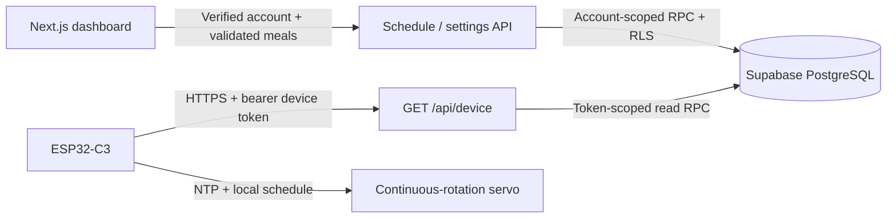

# Architecture

The website is a shared service where each signed-in user manages their own settings. The ESP32-C3 code is public, open-source firmware that users download and install themselves. Users connect their ESP using their personal device token; they do not provision a database or configure the website backend.

The website operator configures the shared Supabase project once. Developer environment and migration instructions stay in repository documentation. Public pages cover account usage and firmware installation only. The firmware preserves its original GPIO9 pin.

The web app remains at the repository root so its existing Next.js deployment root does not change. Firmware is a separate PlatformIO project inside `firmware/`; there are no submodules or nested Git repositories.

## Trust boundaries

- Browser clients use the public Supabase anon key and a user session.
- Server routes verify the account with `auth.getUser()`.
- Middleware refreshes cookies on protected page entry points; routes independently enforce authorization.
- Schedule replacement and token rotation derive ownership from `auth.uid()`, never from request JSON.
- RLS permits authenticated users to read their own records. Browser roles cannot write tables directly.
- Security-definer functions have an empty search path, explicit schema qualification and restricted execute grants.
- The unauthenticated device client receives only schedule fields from `get_device_schedule` after token validation. It has no service-role key and no user cookies.
- The device API sends `Cache-Control: private, no-store`. New firmware avoids tokens in URLs.

## Data flow

The dashboard sends a complete schedule to `PUT /api/schedule`. TypeScript validates and sorts it; PostgreSQL validates it again and replaces the account's rows in one transaction under a per-account lock. Device reads observe either the previous committed schedule or the new schedule.

Firmware polls every 5 minutes and atomically accepts a complete validated response, including `[]`. Failed requests retain the cached schedule. Scheduling runs independently from Wi-Fi after NTP synchronization. No device heartbeat/telemetry is implemented, so the dashboard describes the polling interval without claiming that a device is online or an update is already applied.

## Shared limits

The TypeScript contract is in `lib/schedule.ts`, SQL checks are in the initial migration, and firmware limits are in `AppConfig.h` / `ConfigClient.cpp`. Keep these boundaries aligned when changing the protocol. Automated tests cover API and SQL limits; firmware compilation covers the embedded sources.
